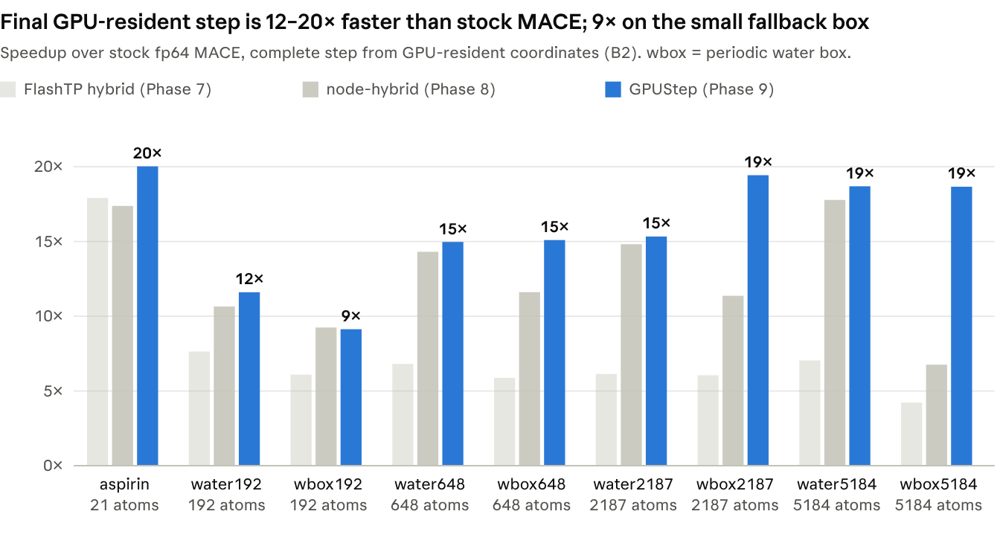

# MACE-OFF23 on H100: how inference got 9–20× faster

2026-11-24

## Executive summary

A complete MACE-OFF23 medium fp64 energy+force step on one H100 now takes 0.81 ms for aspirin and 23.9 ms for a 5,184-atom periodic water box, against 16.3 ms and 446 ms for stock MACE: 12–20× faster on every system the new neighbour list supports, and 9× on the one small periodic box that falls back to the old builder, with fp64 accuracy unchanged.

- **What "step" means here:** neighbour list plus forward and backward pass, starting from coordinates already on the GPU (boundary B2, defined below). Sustained MD (B3) shows the same ratios against stock ASE-driven MD.
- **Accuracy:** every path stayed within 1e-11 eV/atom and 1e-11 eV/Å of stock eager fp64 MACE; worst measured values were about 1e-12 eV/atom and 2e-14 eV/Å. NVE drift matches stock within block noise.
- **No single trick did it.** The gain is the product of five changes, each removing whatever was the bottleneck after the previous one:
  1. replace the two slow equivariant operators with faster kernels (FlashTP convolution with a fixed fp64 Clebsch–Gordan table, cuEquivariance symmetric contraction);
  2. capture the whole model in a CUDA graph, removing the CPU launch floor that dominated every system under about 650 atoms;
  3. fuse the edge embedding and post-convolution node ops into custom kernels (halving graph node count);
  4. write a node-centric fp64 convolution, 2.2× faster per replay than FlashTP at 648 atoms;
  5. build the neighbour list on GPU with a cell list and capture the entire MD step, removing all host synchronisation.
- **Where it stops:** at 2,000+ atoms the GPU is now about 99% busy inside the model itself. Further gains need model-kernel work (convolution backward, radial-MLP GEMMs, elementwise glue), not more pipeline work.
- **One correctness finding worth carrying forward:** upstream FlashTP silently rounds its Clebsch–Gordan coefficients to fp32 even in fp64 mode, giving 3–10e-8 eV/Å force errors. We fixed this with a 40-line local patch (not sent upstream).

## Setup and methodology

All numbers come from single H100 80GB HBM3 GPUs (SM clock 1980 MHz, logged per job) on a Slurm cluster, using the public MACE-OFF23 medium checkpoint in fp64.

| Item | Value |
| --- | --- |
| Model | MACE-OFF23 medium (ACEsuit/mace-off @ 91a78c5), r_max 5.0 Å, 2 interaction layers, L0 128×0e → L1 128×(0e+1o), fp64 |
| Software | mace-torch 0.3.17, e3nn 0.4.4, torch 2.11.0+cu128, Python 3.11.17, contained CUDA 12.8.1 nvcc |
| Kernel libraries | FlashTP (SNU-ARC, d52e414 + local patches), cuEquivariance 0.10.0, OpenEquivariance 0.8.0, LunaTP 0.2.0 (last two evaluated only) |
| Systems | H2O, aspirin (21), organic clusters (196, 650), water clusters (192, 648, 2187, 5184), periodic water boxes (192, 648, 2187, 5184), zero-edge cases |
| Timing | median [p10–p90] of ≥50 reps after ≥10 warmups, CUDA-synced; key tables reproduced in two separate jobs (agreement within 0.5–2%) |
| Correctness gate | vs eager stock fp64 MACE: \|dE\|/atom ≤ 1e-11 eV, max \|dF\| ≤ 1e-11 eV/Å, stress ≤ 1e-14 eV/ų, neighbour sets bitwise equal |

Three timing boundaries, always compared like for like:

- **B1, replay:** energy+forces with a prebuilt neighbour graph (model only).
- **B2, complete step:** from coordinates already on the GPU, including neighbour construction and any host sync it needs.
- **B3, sustained MD:** ms per velocity-Verlet step, including integration and all host interaction actually required.

Earlier phases sometimes quote a step from host coordinates (e.g. 3.669 ms for water648 in Phase 8); that is a different boundary and is labelled where used.

## Why stock MACE is slow

Stock MACE loses time in three different places, and which one dominates depends on system size: CPU launch overhead below about 650 atoms, two generic equivariant operators above it, and host-side graph construction everywhere.

| Bottleneck | Evidence (Phase 6 profile, torch.profiler/CUPTI, job 1017) |
| --- | --- |
| CPU launch floor | Each forward issues 250–300 kernels and each backward 330–560. At aspirin the GPU is busy 0.9 ms of a 6.1 ms forward (84–86% idle); at 192 atoms 21–48% idle. The floor is Python and dispatcher overhead, not the launch API (only 10–15% of CPU time). |
| e3nn convolution | At water648 the conv is 5.7 ms forward and 13.6 ms backward: generic elementwise kernels on [E, 2048/5120] fp64 edge tensors (mul 17%, add 14%, copy 9% of GPU time). It also saves 2.9 GB of edge tensors for backward. |
| e3nn symmetric contraction | 5.7 ms forward / 6.6 ms backward at water648; together with the conv about 85% of GPU time. |
| Graph construction | Stock make_batch_dict takes 2.6 ms (aspirin) to 9.1 ms (water648): CPU neighbour list via matscipy plus 26–37 pageable host-to-device copies, each followed by a stream sync. At 5,184 atoms in a periodic box, the O(N²) GPU builder used through Phase 8 took 42 ms per step. |

The practical consequence: a faster kernel alone could not help small systems, and removing the launch floor alone could not help large ones. Each later phase targets one row of this table.

## Where the speedup came from, phase by phase

The speedup compounds: each phase removed the bottleneck the previous one exposed, and the biggest single jumps were CUDA-graph capture for small systems (up to 12×) and the node-centric convolution plus GPU neighbour list for large ones (2.2× and 2.8×).

| Phase | Change | Bottleneck removed | Measured effect (system, boundary) |
| --- | --- | --- | --- |
| 3–4 | Hybrid backend: FlashTP fused convolution (fp64 CG patch) + cuEquivariance symmetric contraction, installed as an in-memory module swap | Generic e3nn conv and symmetric contraction | water648 model fwd+bwd 36.6 → 17.4 ms (2.1×), saved-for-backward memory 4.24 → 0.76 GB. Slower at aspirin (13.8 → 17.0 ms) because cuEquivariance adds host-side cost |
| 5 | GPU neighbour-list prototype (O(N²) brute force) replacing matscipy + collate | 2.6–9.1 ms CPU graph build and 26–37 synced copies | Graph build 0.43 ms at small N; still O(N²) and still syncs once |
| 6–7 | Whole model captured in a CUDA graph, padded edges (E_cap = 1.2E), keyed recapture | CPU launch floor (250–560 launches per pass) | aspirin hybrid 16.9 → 1.36 ms replay (12×); 192-atom organic 16.9 → 2.3 ms (7×). Launch API calls 601 → 11 |
| 7 | Fused kernels: edge embedding (spherical harmonics + Bessel radial + cutoff, fwd+bwd, CUDA) and post-conv node op (linear + 1/avg_neighbours + skip_tp per-species fold, Triton fp64) | ~300 small elementwise/GEMM kernels per replay | Graph nodes 599 → 288; replay aspirin 1.37 → 0.74 ms (−46%), water648 7.68 → 6.50 ms (−15%) |
| 8 | Node-centric fp64 tensor-product convolution: destination-owned forward, source-centric fused backward, shared CSR | FlashTP conv was 54–72% of replay at 192–648 atoms | Replay water648 6.50 → 3.00 ms (2.17×), wbox648 8.36 → 3.67 ms (2.28×); conv share down to 36–38%. 5–11% slower at H2O/aspirin |
| 9 | GPU cell-list builder emitting destination-sorted edges + CSR; neighbour build + model fwd/bwd in one CUDA graph; GPU velocity Verlet | O(N²) builder (64% of step at 5,184 atoms) and 29 host syncs per step | Complete step wbox5184 66.0 → 23.9 ms (2.76×), wbox2187 18.4 → 10.7 ms (1.71×); clusters 1.03–1.09×; host syncs 29 → 0 |

Two patterns run through this table:

- **Memory traffic, not FLOPs, set the pace.** The e3nn conv materialised [E, 5120] fp64 edge tensors; FlashTP and then the node-centric kernel avoid writing per-edge outputs at all, and the node-centric version owns each destination node so it needs no atomics in forward.
- **Removing a bottleneck only pays where it dominates.** CUDA graphs gave 12× at 21 atoms and 1.2× at 192 e3nn atoms; the cell list gave 2.8× on periodic 5,184-atom boxes and under 10% on clusters, where the old builder was only 3–6% of the step.

## Correctness: the speed did not come from lower precision

Every optimised path was gated against eager stock fp64 MACE, and the final GPU-resident step stays within 1.1e-12 eV/atom and 2.1e-14 eV/Å, about 1,000× inside the 1e-11 gate.

- **The FlashTP precision bug.** Unmodified FlashTP in fp64 mode gave 2–3e-9 eV/atom and 3–10e-8 eV/Å errors against e3nn. The cause: `extract_cg_info()` rounds every Clebsch–Gordan value to fp32 before building its table, and `wigner_3j()` ignores the requested dtype. A 4-file, +40/−9 local patch keeps fp64 values (dedupe tolerance 1e-12, safe because distinct CG values differ by ≥5.5e-6 up to l = 6). After it, errors fell to 1.5e-13 eV/atom and 5e-15 eV/Å. FlashTP's own test reported the unpatched version as passing, which is why we never accepted its verdict.

| Check | Samples | Worst \|dE\|/atom (eV) | Worst max \|dF\| (eV/Å) | Worst stress (eV/ų) |
| --- | --- | --- | --- | --- |
| Phase 7 graphed + fused, 5 configs, walks + recapture + traps | 450 | 9.0e-13 | 3.6e-14 | 1.1e-16 |
| Phase 8 node-hybrid, same suite | 180 | 1.07e-12 | 6.5e-13 (where \|F\| ≈ 300 eV/Å) | 1.1e-16 |
| Phase 9 neighbour builder: 187 tests, bitwise edge sets | 187 | 9e-13 | 8.5e-14 | ≤1e-16 |
| Phase 9 integrated step vs stock, 10 systems | 98 | 1.1e-12 | 2.1e-14 | 7.0e-17 |
| Phase 9 MD, 11 systems × 3 force providers, 500–1,000 steps | all sampled | 1.3e-12 | 8.4e-15 | 4.7e-17 |

- **Edge cases covered:** zero-edge systems, an isolated atom (force exactly zero), species-order and atom-count changes that must not reuse a stale graph, capacity overflow and recapture, bin overflow, periodic and mixed-periodicity cells, and a deliberately broken run (one dropped edge) that the harness caught.
- **Overflow never fails silently.** On overflow the model is fed an all-padding graph and returns NaN, so an unchecked result cannot look valid.
- **Energy conservation.** NVE drift over 2 ps matches stock within block noise: water192 at 0.5 fs, −5.95e-6 vs −5.78e-6 eV/atom/ps; wbox648 at 0.25 fs, −2.86e-6 vs −2.53e-6. Drift scales roughly with dt², and Phase 8 and Phase 9 trajectories were bitwise identical over 2 ps.

## Final timings and the remaining bottleneck

At the complete-step boundary the final pipeline is 12–20× faster than stock MACE (9× for the small fallback box), and the last phase mattered most for large periodic boxes, where it beat the Phase 8 pipeline by 2.8× at 5,184 atoms.



*Source: `results/int9/final_tables.md`, Phase 9 jobs 1145/1146, medians of 60 reps, one H100 each.*

| System | Atoms | Stock (ms) | FlashTP hybrid, Phase 7 (ms) | Node-hybrid, Phase 8 (ms) | GPUStep, Phase 9 (ms) |
| --- | --- | --- | --- | --- | --- |
| aspirin | 21 | 16.3 | 0.910 | 0.938 | 0.814 |
| water192 | 192 | 18.1 | 2.37 | 1.70 | 1.56 |
| wbox192 (fallback) | 192 | 22.0 | 3.61 | 2.38 | 2.41 |
| water648 | 648 | 45.5 | 6.68 | 3.18 | 3.04 |
| wbox648 | 648 | 56.3 | 9.58 | 4.85 | 3.73 |
| water2187 | 2187 | 141.8 | 23.1 | 9.57 | 9.25 |
| wbox2187 | 2187 | 208.7 | 34.5 | 18.36 | 10.74 |
| water5184 | 5184 | 400 | 56.8 | 22.5 | 21.4 |
| wbox5184 | 5184 | 446 | 105.6 | 66.0 | 23.9 |

- **Sustained MD (B3)** tracks B2 within a few percent: 24.1 ms/step at wbox5184 against 438 ms with stock MACE driven by ASE (18×), with 0 host syncs per step plus one overflow check every 10 steps. Stock needs 38 syncs per step and ASE 43.
- **Memory:** 9.6 GB peak at wbox5184 against 43 GB for stock.
- **The one regression** is wbox192 (2.41 vs 2.38 ms): its 15 Å cell is below the cell-list minimum, so it uses the older synced builder.

**Profiler evidence (wbox5184, Phase 9 job 1145).** The neighbour list fell from 42.0 ms to 0.05 ms and host syncs from 29 to 0. The GPU is now about 99% busy inside the model: convolution backward 27%, radial-MLP GEMMs 25%, elementwise kernels 23%, fused node op 10%, convolution forward 9.5%.

## What did not work, and caveats

The main limits are that small systems gained least from the last two phases and that some geometries still fall back to slower code.

- **Small systems regressed in Phase 8.** The node-centric conv was 5–11% slower than FlashTP at H2O and aspirin: a 35 µs CSR radix sort, and only 21 CTAs on 132 SMs in backward. Phase 9 removed the sort, and aspirin ended at 0.814 ms vs 0.910 ms for FlashTP-hybrid.
- **Water clusters barely moved in Phase 9** (1.03–1.09×): the model, not the neighbour list, is the limit there. The 1.5× stretch target was met only for periodic boxes.
- **Replay alone (B1) is 0.04–0.2 ms slower** than Phase 8 at 2,187+ atoms; about 50 µs is rebuilding spread padding edges.
- **Unsupported geometries** use the older synced builder: periodic cells under about 15 Å per side, mixed periodicity, degenerate cells. A capturable O(N²) stub takes about 4 ms at 192 atoms, so it was not adopted.
- **Cell changes (NPT)** force a new CUDA graph per cell.
- **Libraries evaluated but not adopted:** cuEquivariance's fused convolution, OpenEquivariance 0.8.0 and LunaTP 0.2.0. LunaTP overlaps the node-centric idea but its graph construction needs a host readback, so it cannot be captured; its published training gains were not shown to carry over to this inference case.
- **Bugs found on the way:** padding edges all on one atom made steps 10–40× slower; a full bin caused an illegal memory access; Python GC during capture invalidated a graph; an adapter edge-index cache returned stale results in Phase 3; FlashTP silently failed graph capture until its kernels launched on torch's stream. All were fixed and kept as labelled superseded runs.
- **Measurement noise:** some Phase 9 drift jobs ran 5–16× slow for about 17 minutes; reruns were bitwise identical at normal speed, so the cause was outside the jobs.

## Next research directions

The next gains have to come from the model kernels, because at 2,000+ atoms the GPU is about 99% busy inside the model and the pipeline around it is no longer the limit.

1. **Convolution backward (27% of the step).** Split backward by channel chunk for better occupancy, and fuse the source-centric gradient with the radial-weight gradient.
2. **Radial-MLP GEMMs (25%).** The per-edge MLP producing tensor-product weights runs as separate fp64 GEMMs; fusing it into the convolution would avoid writing [E, 1280] weights to memory.
3. **Elementwise glue (23%).** Remaining activation, gather and reduction kernels are candidates for one more round of fusion.
4. **Smaller pipeline items:** emit spread padding directly from the builder (~50 µs), a capturable builder for small cells, and recapture-free cell updates for NPT.

A fused whole-layer kernel ("megakernel") is the logical end point, but the profile says to start with the three items above, which together are three quarters of the remaining time.

## Reproduction

All scripts, results, logs and the local FlashTP patches are in this repository; `STUDY_INDEX.md` lists every script and result by phase.

- Environment: `source env.sh` (contained CUDA 12.8.1, uv-managed Python 3.11.17, `venv-cueq`). Venvs, the CUDA toolkit, upstream checkouts and the checkpoint are not in the repo; the checkpoint comes from ACEsuit/mace-off @ 91a78c5 (sha256 4842c52a…).
- Files over 5 MB (captured tensors, Nsight Compute reports) are listed with sha256 in `LARGE_FILES_MANIFEST.txt`.
- Final Phase 9 runs (one H100 each):

```
srun -p h100 --gres=gpu:1 -c 8 -t 00:50:00 bash scripts/int9/run_test_full.sh        # integrated correctness
srun -p h100 --gres=gpu:1 -c 8 -t 01:00:00 bash scripts/int9/run_final.sh A prof     # timing A + profiles
srun -p h100 --gres=gpu:1 -c 8 -t 01:00:00 bash scripts/int9/run_final.sh B          # timing B
TIMING=1 srun -p h100 --gres=gpu:1 -c 8 -t 00:40:00 bash scripts/int9/job.sh ../md9/b3bench.py gpustep,graphed <systems>
```

| Component | Path |
| --- | --- |
| GPU cell-list neighbour builder | `scripts/nl9/cell_nl.py` |
| Whole-step CUDA graph (GPUStep) | `scripts/int9/gpu_step.py` |
| Node-centric conv, external CSR | `scripts/int9/nodeconv_ext.py`, `scripts/nodetp8_fwd/`, `scripts/nodetp8_bwd/` |
| Fused edge embedding / node op | `scripts/fuse7_embed/`, `scripts/fuse7_node/` |
| Graphed runner | `scripts/graphed7/graphed_runner.py` |
| GPU velocity Verlet + MD checks | `scripts/md9/` |
| FlashTP fp64 CG + graph-capture patches | `patches/` |
| Final tables | `results/int9/final_tables.md`, `prof_tables.md`, `correctness_table.md`, `results/md9/MD9.md` |
